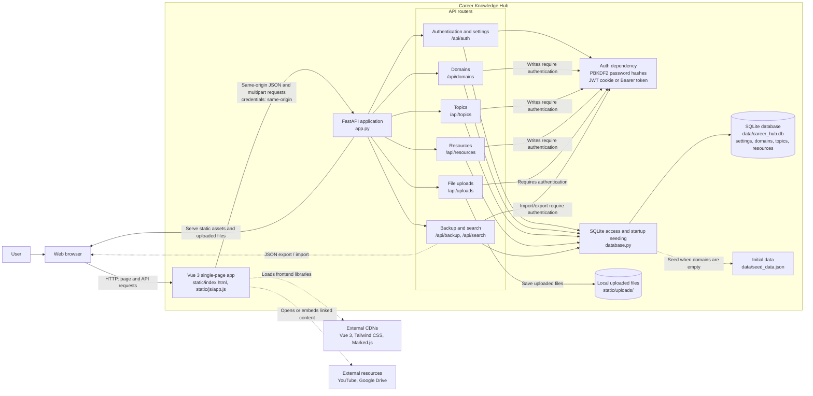

# High-Level Architecture

## Diagram notes

- On startup, the FastAPI lifespan initializes the SQLite schema and seeds default data when the domains table is empty.
- Domain, topic, resource, and settings changes are persisted in SQLite. Uploaded files are stored under `static/uploads/` and served as static files.
- Authentication is enforced by the API routes that use the `require_auth` dependency. The auth status and login endpoints are used by the frontend to manage the session.
- The browser loads Vue, Tailwind CSS, and Marked.js from external CDNs. YouTube and Google Drive are linked or embedded content, not backend services.
- Backup export and import exchange JSON through the browser; GitHub backup/restore is a user-driven workflow.

## Import into diagrams.net (draw.io)

Create a new diagram, choose **Arrange → Insert → Advanced → Mermaid**, then paste the Mermaid source from the code block above. The Markdown file is the editable source for the diagram.
